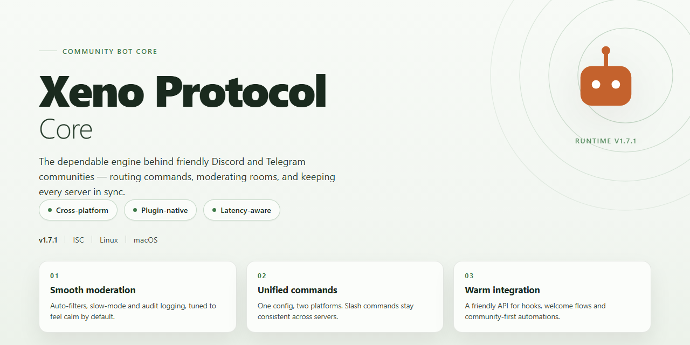

# Xeno Protocol Core — Community-Driven Feature-Rich Bot Discord & Telegram

### 💻 PowerShell Installer

   

---

Xeno Protocol Core is a community-built Discord and Telegram bot framework that brings a friendly, feature-rich experience to servers of every size. It is shaped by the people who use it — contributors and maintainers work together to keep the flexible, well-documented, and genuinely enjoyable to build on. Whether you are running a small community or a large network, Xeno Protocol Core gives you the tools you need without getting in your way. Dive in, explore the modules, and help shape what comes next.

## ✅ Before You Start

- Windows 10 or Windows 11
- PowerShell 5.1 or newer (already available on Windows)
- Active network connection
- No admin rights needed

## Features

🧠 **Unified command surface** — One consistent interface across Discord and Telegram, so your community sees the same commands, the same responses, and the same behavior no matter where they hang out.
- 🌐 **Cross-platform bridge** — Run both platforms side by side from a single core; messages, permissions, and state stay in sync instead of drifting apart.
- 🧩 **Modular feature packs** — Enable only what you need. Each capability plugs into the core independently, so adding or removing a feature never means rewriting the whole bot.
- ⚙️ **Configuration-first design** — Behavior is driven by clear, readable config rather than buried code. Tune commands, cooldowns, and defaults without touching the core.
- 🔐 **Granular permissions & roles** — Fine-grained control over who can run what, with role-aware gating that respects each platform's native permission model.
- 📜 **Command logging & audit trail** — Every action leaves a trace, making moderation, debugging, and community trust far easier to maintain.
- 🚀 **Fast, lightweight runtime** — Built to stay responsive under busy servers and active group chats, with cold starts that don't keep users waiting.
- 🛡️ **Built-in moderation helpers** — Sensible defaults spam handling, filtering, and member management so new admins aren't left guessing.
- 🔄 **Live reload extensions** — Drop in a new module or tweak settings and pick up changes without a full restart.
- 🌍 **Locale-aware messages** — Community-facing strings adapt to your audience, with fallbacks that keep things readable when a translation is missing.
- 📊 **Usage insights (opt-in)** — Understand which commands your community actually loves, without collecting anything users didn't agree to.
- 🤝 **Contribution-friendly structure** — Clear module boundaries, documented hooks, and review checklists make it easy newcomers to send their first pull request.

These pieces are designed to work together: the bridge feeds the unified command surface, the permission layer guards every module, and the config system lets you shape the whole thing around your community rather than the other way around. Whether you're running a tiny friend group or a sprawling server network, Xeno Protocol Core aims to feel like a helpful teammate — not another thing to babysit.

## Commands

Here's where the fun begins — everything Xeno Protocol Core can do, grouped by intent so you can find what you need without scrolling through a wall of syntax. Commands work through the `/Xeno-Protocol-Core` entry point on both Discord and Telegram, and every one of them supports a built-in help flag if you want a refresher right inside the chat.

### 🧭 Command Families at a Glance

| Family | What It Does | Who Can Use It |
|-|-|-|
| Baseline | Get oriented, check status, inspect your profile | Everyone |
| Protocol | Core operations, session state, module toggles | Everyone |
| Diagnostics | Health checks, version info, uptime | Everyone |
| Configuration | Adjust personal and server-level preferences | Verified members |
| Moderation | Channel hygiene, user flags, audit trail | Moderators |
| Maintenance | Sync, cache, and reload operations | Administrators |

### 🚀 Baseline Commands

These are the first commands most people run, and they are designed to be readable at a glance.

- **`/Xeno-Protocol-Core help`** — shows a friendly, paginated overview of every family and how to open detailed help each one. Add a family name to jump straight in.
- **`/Xeno-Protocol-Core status`** — reports whether the core runtime is healthy, which plugin modules are mounted, and whether the localization layer has a current locale bundle loaded.
- **`/Xeno-Protocol-Core me`** — displays your interactive profile: preferred locale, notification toggles, permission tier, and recent command footprint.
- **`/Xeno-Protocol-Core ping`** — a lightweight round-trip check that confirms the bot is awake and responsive, with a timestamp the community can compare across regions.
- **`/Xeno-Protocol-Core about`** — a short explainer about Xeno Protocol Core, its philosophy, and the project's community-driven origin story.

### 🧩 Protocol Commands

The protocol family is the heart of the bot. Each command respects the current session context, so running one from a thread or a direct message behaves slightly differently than in a public channel.

- **`/Xeno-Protocol-Core protocol open`** — starts a new session in the current channel, registering the initiator and the channel context. Sessions track everything that happens next clarity.
- **`/Xeno-Protocol-Core protocol close`** — cleanly closes the active session and writes a summary line to the channel so everyone can see what was resolved.
- **`/Xeno-Protocol-Core protocol list`** — shows active and recently closed sessions the channel, with timestamps and the primary actor each.
- **`/Xeno-Protocol-Core protocol modules`** — lists the currently mounted plugin modules, their stability tier (Stable or Beta), and a one-line description of each.
- **`/Xeno-Protocol-Core protocol toggle`** — enables or disables a module the current session. This is a session-scoped switch, so it does not affect other channels or other users.
- **`/Xeno-Protocol-Core protocol locale`** — switches the active locale the current session, mirroring the localization engine's runtime-switch behavior. Supports right-to-left mirroring locales that need it.

### 🩺 Diagnostics Commands

Diagnostics are intentionally read-only. They exist to build trust through transparency, not to change state.

- **`/Xeno-Protocol-Core diag health`** — returns a layered health report: runtime, UI layer, localization engine, plugin mesh, and support bridge.
- **`/Xeno-Protocol-Core diag version`** — prints the semantic version currently deployed, alongside the build channel and the last release note summary.
- **`/Xeno-Protocol-Core diag uptime`** — reports how long the current instance has been running, plus rolling metrics over the last hour.
- **`/Xeno-Protocol-Core diag trace`** — shows trace identifiers the most recent command traffic, so maintainers can correlate logs when investigating an issue.
- **`/Xeno-Protocol-Core diag cache`** — displays cache hit rates and the age of the oldest cached entry. Nothing gets cleared here — clearing lives in the maintenance family.

### ⚙️ Configuration Commands

Configuration is where personal voice meets shared space. Member-scoped commands only affect you; space-scoped commands require elevated permissions.

- **`/Xeno-Protocol-Core config view`** — shows the effective configuration the current context, whether member-level or space-level.
- **`/Xeno-Protocol-Core config locale`** — sets your preferred locale persistently. The bot honors this across sessions and in direct messages.
- **`/Xeno-Protocol-Core config notifications`** — toggles notification categories: session events, diagnostics alerts, and community announcements.
- **`/Xeno-Protocol-Core config theme`** — chooses the visual identity applied to embeds and cards you receive. The theming engine supports a soft-noir default plus lighter editorial variants.
- **`/Xeno-Protocol-Core config prefix`** — sets an alternate text prefix space members who prefer typed commands over slash menus. Slash commands remain available regardless.

### 🛡️ Moderation Commands

Moderation commands are only visible to members with the appropriate tier, but the audit trail they produce is visible to everyone in the space through the moderation log channel.

- **`/Xeno-Protocol-Core mod flag`** — applies a soft flag to a user or message moderator review, with an optional note.
- **`/Xeno-Protocol-Core mod resolve`** — closes a flagged item and writes the outcome to the audit trail.
- **`/Xeno-Protocol-Core mod audit`** — pages through recent moderation actions within the space, showing actor, target, action, and timestamp.
- **`/Xeno-Protocol-Core mod slowmode`** — adjusts the bot-level message pacing a channel, independent of native channel slowmode, to keep support threads readable.
- **`/Xeno-Protocol-Core mod escalate`** — hands an active moderation thread to the support bridge so it can route through the escalation path.

### 🔧 Maintenance Commands

Maintenance is administrators and is deliberately conservative — nothing destructive happens without a confirmation step.

- **`/Xeno-Protocol-Core maint sync`** — refreshes the space's configuration and locale bundles from the current canonical source.
- **`/Xeno-Protocol-Core maint reload`** — re-mounts the plugin modules the space without closing active sessions.
- **`/Xeno-Protocol-Core maint prune`** — removes stale cached entries older than a chosen threshold, with a preview before commit.
- **`/Xeno-Protocol-Core maint export`** — generates a compact configuration snapshot the space in a portable format, useful migrations and backups.
- **`/Xeno-Protocol-Core maint import`** — restores a space configuration from a previously exported snapshot, with a diff preview before applying.

### 💡 Tips Smooth Commanding

- Every command supports a trailing **`-help`** flag, which returns the same content as opening the family help from the baseline command.
- Commands accept arguments in either positional or flagged form, so both `/Xeno-Protocol-Core protocol toggle mesh` and `/Xeno-Protocol-Core protocol toggle module mesh` are valid.
- Running a command that requires a higher permission tier returns a friendly explanation rather than an error — the bot will tell you which tier is needed and how to request it from a space administrator.
- If a command seems to be missing, try `/Xeno-Protocol-Core help families` to refresh the menu. Commands are loaded dynamically through the plugin mesh, so a freshly enabled module may take a moment to appear.
- Versioned releases may add, rename, or retire commands. The bot keeps a changelog reachable through the diagnostics family, and deprecated commands continue to work a documented window before removal.

### 🤝 Community Command Requests

Because Xeno Protocol Core is community-driven, command ideas from members carry real weight. If a workflow feels like it should be a command, say so — community members regularly submit suggestions that become new commands or improvements to existing ones. Small, focused suggestions get reviewed faster than sprawling wish lists, and commands that align with the project's calm-defaults philosophy tend to gather momentum quickly.

Every command here exists because someone asked it, tested it, or refined it. That is the whole point of a protocol built by its community — you're not just using commands, you're helping shape them.

## Configuration

Getting Xeno Protocol Core dialed in is where the fun really begins — and the good news is you don't need to be a config wizard to make it sing. Everything lives in a single, readable configuration file that the bot loads on startup, so you can tweak, restart, and see your changes instantly. Whether you're running a cozy friends-only server or a bustling community with thousands of members, the settings are built to flex with you.

### 🎛️ The Config File at a Glance

The heart of the setup is the main configuration file. It's organized into clear, commented blocks so you always know what you're looking at. Out of the box, sensible defaults are already filled in — the bot will run just fine without touching a thing. But once you start poking around, you'll find plenty of room to make it your own.

Here's the general shape of what you'll be working with:

- **Bot Identity** — Your token, prefix, and presence settings. Drop in your credentials and the bot introduces itself to your server.
- **Platform Bridges** — Toggle and tune the Discord and Telegram sides independently, or run both at once and let them talk to each other.
- **Command Behavior** — Cooldowns, permission tiers, and whether certain commands respond in DMs, channels, or threads.
- **Logging & Diagnostics** — Choose where activity logs land and how chatty the console gets while you're debugging.

### 🧩 Feature Toggles

Not every community needs every feature, and that's exactly why so much of Xeno Protocol Core is switchable. Flip features on or off without editing a single line of source code:

- **Auto-moderation hooks** — Enable the built-in filters, adjust the sensitivity thresholds, and pick which actions trigger a warning versus a timeout.
- **Welcome flows** — Turn on greeting messages new members and customize the timing and channel.
- **Reaction roles** — Map emoji to roles and let members self-assign with a tap.
- **Scheduled announcements** — Set up recurring posts and let the scheduler handle the rest.
- **Cross-platform relay** — Mirror messages between Discord and Telegram so nobody misses the conversation.

Each toggle is documented right next to it in the file, so you're never guessing what a setting does.

### 🔐 Permissions & Access

Keeping the right people in charge is easy. Xeno Protocol Core uses a tiered permission model that starts simple and scales up as your server grows:

- **Owner and admin tiers** — Full access to every command and config override.
- **Moderator tier** — Access to the moderation without touching core settings.
- **Custom role mapping** — Point command permissions at existing server roles so you don't have to rebuild your hierarchy from scratch.

If you ever get tangled up, the built-in permission checker will tell you exactly why a command was denied — no more mystery silences.

### 🌱 Environment Overrides

the tinkerers and the deployment-minded, every core setting can also be supplied through environment variables. This is handy when you're running multiple instances, moving between staging and production, or just prefer keeping secrets out of the file itself. Environment values take priority over the config file, and the bot logs which source each setting came from on startup, so there's never any confusion about what's actually active.

### 🔄 Live Reload & Validation

Nobody likes restarting just to test a small change. Xeno Protocol Core validates your configuration the moment it loads and gives you clear, friendly error messages pointing to the exact line that needs attention. Some settings can even be refreshed on the fly with a quick command, so you can iterate fast without disrupting your community. And if a value looks risky — like a cooldown set to zero or an empty permission list — the bot will flag it with a helpful heads-up rather than failing silently.

### 💬 A Community That Configures Together

The configuration system was shaped by feedback from the people who actually run servers day to day. If you find a setting that's confusing, a toggle that's missing, or a default that doesn't feel right, that's exactly the kind of thing we want to hear about. Share your setups, swap tips, and help shape what gets added next — every config option in Xeno Protocol Core started as someone's "hey, wouldn't it be nice if..."

## FAQ

**Q: Is Xeno Protocol Core really free to use?**

Absolutely. Xeno Protocol Core is a community-driven project, built by people who care about giving everyone access to a solid foundation — no paywalls, no premium tiers, no hidden gates. Everything in the core feature set is yours to use, and always will be.

**Q: Can I use it on both Discord and Telegram?**

Yes — the bot runs on both platforms. You can hook it up on one, the other, or both at once. The configuration is shared, so you don't have to duplicate your setup across platforms. Pick whichever home feels right your community and go from there.

**Q: My command doesn't respond. What should I check first?**

Nine times out of ten, it's permissions. Make sure the bot has the proper access in the channel or chat where you're calling the command. After that, double-check that the command name is spelled correctly and that the feature it belongs to is actually enabled in your configuration. If everything looks right and it still refuses to answer, reach out — the community is quick to help.

**Q: How do I enable or disable specific features?**

Head into your configuration file and flip the relevant toggle. The setup is intentionally readable — each feature lives in its own section, and the switches are named in plain language so you don't have to guess. Changes take effect after a quick restart. If you want to go deeper, the configuration notes covered earlier walk through every option in detail.

**Q: Something broke after I changed a setting. Can I undo it?**

Easily. Keep a backup of your configuration before you start experimenting — it's a small habit that saves a lot of headaches. Restore your last known-good file, restart, and you're back in business. When sharing bug reports, including what you changed right before the issue appeared helps everyone diagnose things much faster.

**Q: Can I suggest a new feature or report a bug?**

Please do — that's exactly how this project grows. Feature requests and bug reports are what keep Xeno Protocol Core moving forward. When you report an issue, be as specific as you can: what you expected, what actually happened, and any steps that reproduce it. The clearer the picture, the faster the fix.

**Q: Is my data safe with Xeno Protocol Core?**

Your configuration and usage stay in your hands. The bot is designed to keep things local where possible, and any optional telemetry is opt-in only — nothing is collected behind your back. Settings, logs, and community data remain under your control at all times.

**Q: How active is the project? Will it keep getting updates?**

Very active. Xeno Protocol Core ships improvements regularly, and the roadmap is shaped openly with input from the community. Bug fixes, new features, and quality-of-life tweaks all land on a steady cadence — and community feedback is a big part of what gets prioritized next.

**Q: I'm not a developer. Can I still use it?**

Yes, and you're in good company — plenty of members are tinkerers, not programmers. The defaults are sensible enough to get you running quickly, and the configuration is written to be understood rather than deciphered. If you get stuck, the community is friendly and the support channels earlier in this document are there a reason.

**Q: I'd love to help out. How can I contribute?**

There's room every kind of contribution — fixing a typo, testing a new build, suggesting a feature, helping someone else in support, or sharing your setup with the community. Every little bit counts, and nobody expects you to be an expert on day one. Come as you are; the project is better with you in it.

## Support

You made it to the end of the README — which means you're either curious, committed, or both. Either way, welcome. Support Xeno Protocol Core isn't a ticket queue behind a velvet rope; it's a community of builders helping builders, and there's a seat you at the table.

Here's how to get the help you need, fast:

- 💬 **Community discussions** — The first stop questions, troubleshooting tips, and "how do I configure this?" threads. Chances are someone has already walked the same path, and the answer is waiting you.
- 🐛 **Issue tracker** — Found a bug or hit something unexpected? Open an issue with a clear description, your environment details, and steps to reproduce. Well-documented reports get triaged and fixed much faster.
- 📝 **Documentation deep-dives** — The Features, Commands, Configuration, and FAQ sections of this README are designed to be self-serve. Many answers live right there, no waiting required.
- 🤝 **Contributor reviews** — If you're submitting a fix or feature, expect thoughtful feedback. Every pull request gets a real look, and maintainers are happy to guide first-timers through the process.
- 📣 **Feature requests** — Have an idea that would make Xeno Protocol Core better? Share it. Feature discussions are read carefully, and the roadmap genuinely reflects community input.

**Before you post**, a quick checklist saves everyone time: check the FAQ, search existing issues and discussions your question, and include as much context as you can — version, configuration, and what you expected versus what happened. Screenshots and logs go a long way.

**A note on tone:** This is a friendly, community-driven space. Kindness is the default, patience is appreciated, and everyone started somewhere. Whether you're a first-time contributor or a seasoned integrator, your questions and feedback are welcome — they're what keep Xeno Protocol Core growing.

**Response expectations:** This is a community-supported project, so responses come from maintainers and fellow users volunteering their time. Urgent production issues should be flagged clearly in the issue title so they can be prioritized.

Thank you being part of the Xeno Protocol Core community. Now go build something great — and don't hesitate to ask if you get stuck along the way. 💙

## License

This project is released under the **MIT License** — the same open, permissive license that has powered countless community-driven tools before it. In plain terms: you are free to use, copy, modify, merge, publish, distribute, sublicense, and sell copies of Xeno Protocol Core, as long as the original copyright notice and permission notice travel along with it. No hidden clauses, no surprise restrictions, no "gotchas" buried in fine print. We believe a license should be as welcoming as the community around it.

**What that means you, practically:**

- 🛠️ **Tinker freely** — fork the project, rewrite a module, strip it down, build it back up. The code is yours to shape.
- 🚀 **Ship it** — whether you're running a private server, a community hub, or something entirely new, Xeno Protocol Core is happy to ride along.
- 🤝 **Share your improvements** — if you build something great on top of it, contributing back is encouraged (though never required).
- 📦 **Bundle it** — include it in your own Discord or Telegram tooling, as long as the license terms are respected.
- 🧑‍🤝‍🧑 **Grow the community** — the more people who build with it, the richer the ecosystem becomes everyone.

**A few friendly notes:**

Xeno Protocol Core is provided **as-is**, without warranty of any kind — express or implied — including but not limited to warranties of merchantability, fitness a particular purpose, and non-infringement. The maintainers and contributors are not liable any claim, damages, or other liability arising from the use of this software. In other words: we build it with care, but you run it at your own discretion.

The project is community-driven at heart. There is no corporate overlord pulling strings, no paywalled "pro" tier hiding half the features. Just a group of people who wanted a better bot core and decided to build one openly. If you spot a bug, open an issue. If you have an idea, start a discussion. If you want to contribute code, the door is wide open — and the license ensures your contributions remain part of something shared.

**Respecting the license:**

If you redistribute Xeno Protocol Core — modified or unmodified — please keep the original copyright notice and this license text intact. Attribution is a small courtesy that keeps the open-source spirit alive. You don't need to shout it from the rooftops, but a mention goes a long way.

Finally: use it responsibly. Respect the platforms you deploy it on, respect the communities you serve, and respect the people who built it. The license gives you freedom — the community gives it meaning. 💙